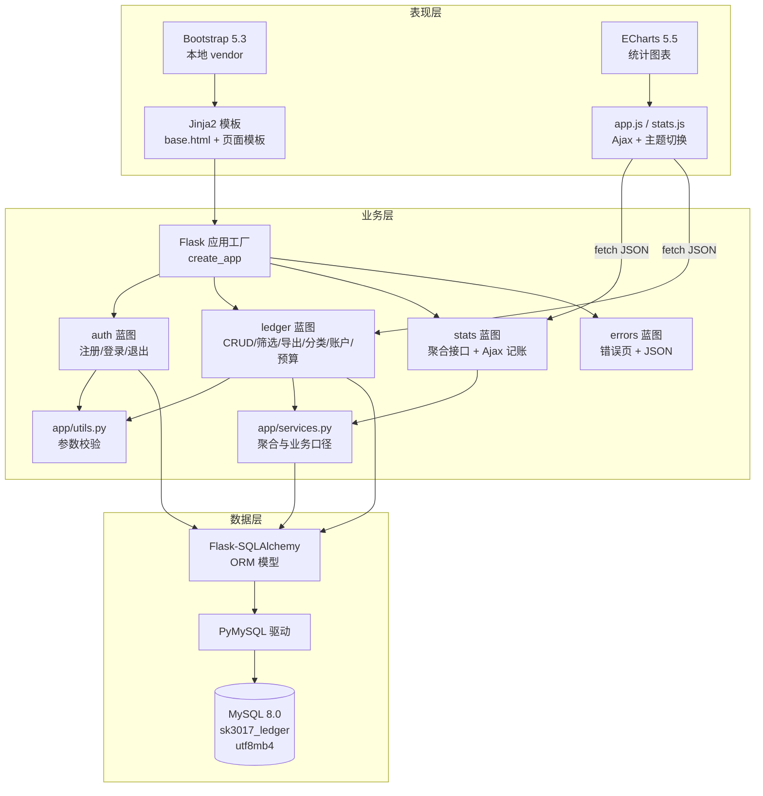
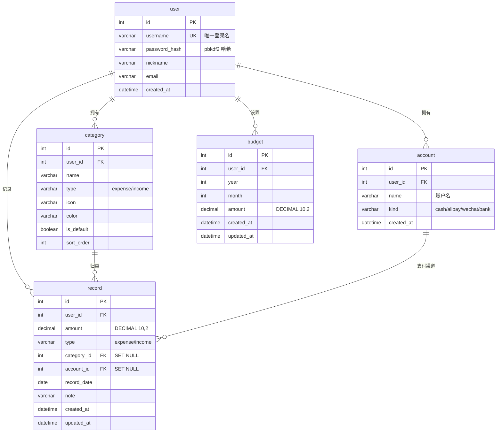
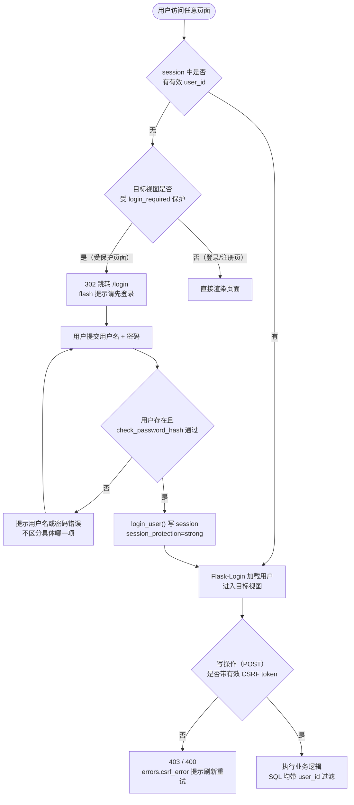
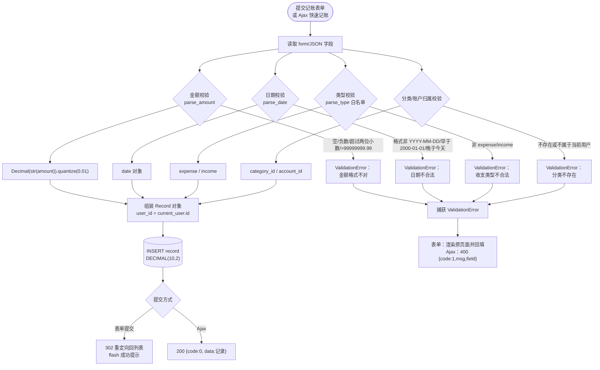
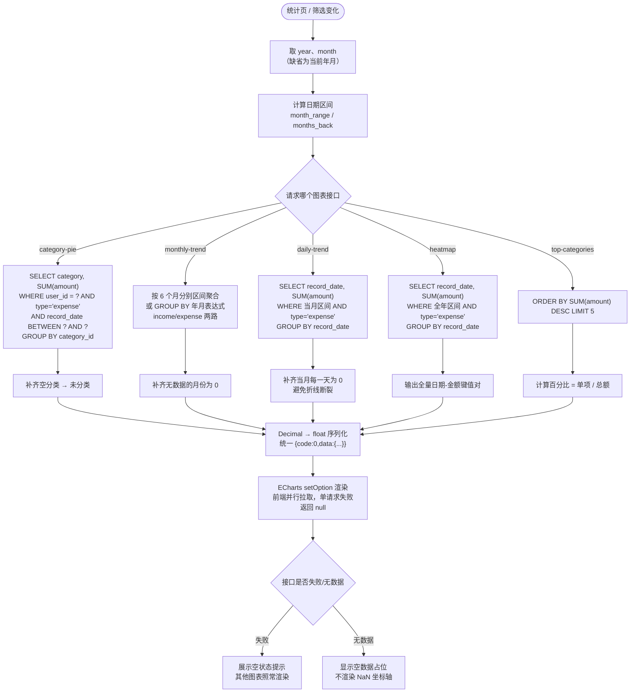

# 个人记账本 Web 应用 — 系统设计文档

> 课程设计选题：题目三-个人记账本（收支管理+图表统计）
> 课程：SK3017《Python Web企业级项目开发》 ｜ 学期：2026-2027 第一学期 ｜ 路线B（题库选题） ｜ 独立完成

本文档记录系统的需求边界、架构分层、数据库结构、核心流程、聚合 SQL 设计与关键技术决策，作为开发、测试与答辩说明的统一依据。文档中的表结构、字段类型与代码保持一致（以 `app/models.py` 为准），如后续修改模型需同步更新本文档。

---

## 一、需求分析

### 1.1 项目背景与目标

个人日常收支记录普遍存在三个痛点：一是记账工具要么过重（记账类 App 要求绑定银行卡、上传凭证），要么过轻（用备忘录记流水，月底无法汇总）；二是"记了但看不懂"，流水是流水，缺少分类占比、月度趋势这类能够支撑消费决策的视图；三是数据存放在第三方平台，隐私与导出能力不可控。

本项目的目标是实现一个**自托管、轻量、可统计**的个人记账本 Web 应用：用户注册后即可按"金额 + 类型 + 分类 + 账户 + 日期 + 备注"记录每一笔收支，通过组合筛选快速定位历史流水，并在统计页用三张核心图表看清"钱花在哪儿、每月花多少、这个月和上个月比是多是少"。系统面向单人单机使用，不做多用户协作与权限体系，但保证不同账号之间的数据完全隔离。

### 1.2 用户故事（User Story）

| 编号 | 角色 | 用户故事 | 验收要点 |
| --- | --- | --- | --- |
| US-01 | 访客 | 作为访客，我希望注册账号并登录，以便拥有自己的账本 | 用户名唯一、密码≥6 位且以 pbkdf2:sha256 哈希存储；未登录访问业务页面自动跳转登录页 |
| US-02 | 用户 | 作为用户，我希望快速记一笔支出或收入，以便随手记账 | 金额、类型、分类必填；金额为正数且最多两位小数，上限 99999999.99；日期不晚于今天 |
| US-03 | 用户 | 作为用户，我希望查看按时间倒序排列的流水并翻页，以便核对 | 每页 10 条；分页参数非法时回落到第 1 页而不是报 500 |
| US-04 | 用户 | 作为用户，我希望按年、月、类型、分类、关键词组合筛选，以便快速找到某笔账 | 五个条件可任意组合，空条件不参与过滤；筛选条件在翻页与导出时保持 |
| US-05 | 用户 | 作为用户，我希望修改或删除记错的账目，以便保证数据准确 | 编辑复用创建表单并回填原值；删除需二次确认，防止误触 |
| US-06 | 用户 | 作为用户，我希望在首页看到本月收支与预算使用情况，以便掌握整体状态 | 概览卡片展示收入、支出、结余、笔数、环比/同比与预算进度条 |
| US-07 | 用户 | 作为用户，我希望在统计页看到分类占比、近 6 个月趋势、当月每日支出，以便分析消费结构 | 三图均由服务端 SQL 聚合，Ajax 随筛选联动刷新，空数据不白屏 |
| US-08 | 用户 | 作为用户，我希望设置月度预算并在接近超支时收到提示，以便控制支出 | 使用率≥80% 黄色提醒、≥100% 红色警示；整数金额与月份校验 |
| US-09 | 用户 | 作为用户，我希望自定义分类与资金账户，以便贴合自己的记账习惯 | 分类支持增删改（图标/颜色）；账户支持现金/支付宝/微信/银行卡类型 |
| US-10 | 用户 | 作为用户，我希望把筛选后的流水导出为 CSV，以便用 Excel 二次分析 | 导出内容与筛选条件一致；UTF-8 BOM 保证 Excel 打开中文不乱码 |
| US-11 | 用户 | 作为用户，我希望在手机和深色模式下也能正常使用，以便睡前记账 | 1920 与 390 宽度下布局可用；深浅主题一键切换并记忆 |

### 1.3 功能范围

**基础必做（11 项）**：注册、登录、退出；记账条目增删改查；年/月/类型/分类/关键词组合筛选；分页（每页 10 条）；金额校验；日期校验；删除二次确认；统计页三图（分类占比饼图、近 6 个月收支并列柱状图、当月每日支出折线图）；服务端 SQL 聚合 + Ajax 联动；seed 演示数据（`demo` 账号，2026-07-15 ~ 2026-10-30 约 3.5 个月、365 条记录、4 条预算）。

**加分项（10 项）**：月度预算与进度条；自定义分类管理；资金账户管理；CSV 导出；年度支出日历热力图；支出 TOP5 + 环比/同比指标卡；首页 Ajax 快速记一笔；深浅色主题 + 响应式；统一 JSON 错误结构与错误页；pytest 自动化测试。

### 1.4 非功能需求

| 维度 | 要求 | 落地措施 |
| --- | --- | --- |
| 性能 | 单用户千级数据下页面首屏 < 1s，统计接口 < 300ms | 复合索引 `(user_id, record_date)`、SQL 聚合不取全表到内存、分页 LIMIT |
| 安全 | 密码不可逆存储，越权不可见他人数据，写操作防 CSRF | pbkdf2:sha256、所有业务查询强制 `user_id = current_user.id`、Flask-WTF 全局 CSRF |
| 可靠性 | 非法输入返回友好提示而非 500 | `app/utils.py` 统一校验函数抛 `ValidationError`，路由层异常兜底 |
| 可维护性 | 按业务域拆蓝图，配置外置 | `auth/`、`ledger/`、`stats/` 三蓝图 + 应用工厂 + `.env` 注入 |
| 兼容性 | Excel 可正常打开导出文件；移动端可用 | CSV 写入 UTF-8 BOM；Bootstrap 5.3 栅格 + 媒体查询 |
| 数据完整性 | 金额无浮点误差，统计不重复计数 | MySQL `DECIMAL(10,2)`，Python 侧 `Decimal` 参与计算 |

---

## 二、系统架构

### 2.1 总体分层

系统采用**服务端渲染为主、Ajax 局部刷新为辅**的经典三层架构，避免为小型项目引入前后端分离带来的构建与鉴权复杂度：

- **表现层**：Jinja2 模板 + Bootstrap 5.3（本地 vendor，非 CDN）+ 少量原生 JavaScript + ECharts 5.5。页面骨架由服务端渲染，统计图表数据与"快速记一笔"通过 `fetch` 调用 JSON 接口，实现筛选联动与无刷新提交。
- **业务层**：Flask 应用工厂创建应用并注册蓝图；`auth` 负责注册登录，`ledger` 负责流水 CRUD、筛选、导出、分类/账户/预算，`stats` 负责聚合查询与 Ajax 记账，`errors` 统一处理 400/403/404/500；业务口径与聚合逻辑集中在 `app/services.py`，参数校验集中在 `app/utils.py`。
- **数据层**：Flask-SQLAlchemy ORM 映射五张表，PyMySQL 连接 MySQL 8.0（utf8mb4）。统计类查询直接写 `select()` + `func.sum()` 等聚合表达式，把计算下推给数据库。



### 2.2 请求生命周期

1. `run.py` 调用 `create_app()`，从 `CONFIG_MAP` 读取配置，初始化 `db / login_manager / csrf`，注册蓝图与 Jinja 过滤器。
2. 请求进入后，`Flask-Login` 的 `load_user` 根据 session 中的 `user_id` 加载用户；受保护视图使用 `@login_required`，未登录跳转 `auth.login`。
3. Flask-WTF 的 `CSRFProtect` 对全部 POST 请求校验 token，失败走 `errors.csrf_error`。
4. 视图解析参数 → 调用 `app/utils.py` 校验 → ORM 查询/写入 → 渲染模板或返回统一 JSON。
5. 任何未被捕获的异常由 `errors` 蓝图统一兜底，返回 500 错误页或 JSON。

### 2.3 模块职责划分

| 文件/目录 | 职责 | 关键约束 |
| --- | --- | --- |
| `app/extensions.py` | 扩展单例 `db / login_manager / csrf` | 单独成模块，避免工厂与模型循环导入 |
| `app/__init__.py` | 应用工厂、蓝图注册、错误处理、Jinja 过滤器与模板 global（`records_url` / `export_url`）、CLI 命令 | 不做具体业务逻辑；模板里不手写分页 query 拼接 |
| `app/models.py` | 5 张表 ORM + 密码哈希 + 预置分类/账户 | 金额 `Numeric(10,2)`，不出现 float 字段 |
| `app/utils.py` | 参数校验、日期区间、金额格式化、CSV 构造 | 服务端二次校验，不信任前端 |
| `app/services.py` | 业务口径与聚合：区间统计、五类图表、预算、概览、筛选查询 | 页面与 JSON 接口复用同一份逻辑，避免两套口径 |
| `app/auth/routes.py` | 注册、登录、退出 | 注册时复制默认分类与账户 |
| `app/ledger/routes.py` | 流水列表/创建/编辑/删除/导出、分类与账户管理、预算 | 所有查询带 `user_id` 过滤 |
| `app/stats/routes.py` | 概览、分类饼图、月度趋势、每日趋势、热力图、TOP5 | 只做聚合，不在 Python 里循环求和 |
| `app/templates/` | 页面模板 | 统一继承 `base.html` |
| `app/static/` | CSS/JS/vendor | Bootstrap 与 ECharts 本地化，不依赖 CDN |
| `database/` | `schema.sql`、`seed_data.py`、`seed.sql` | 与 ORM 模型一致，可独立建库 |

---

## 三、数据库设计

### 3.1 ER 图



### 3.2 表结构

**表 1：`user` 用户表**

| 字段 | 类型 | 约束 | 说明 |
| --- | --- | --- | --- |
| id | INT | PK, AUTO_INCREMENT | 主键 |
| username | VARCHAR(32) | NOT NULL, UNIQUE | 登录名，注册时校验 2~20 位中英文/数字/下划线 |
| password_hash | VARCHAR(255) | NOT NULL | `generate_password_hash(method="pbkdf2:sha256")` 结果，永不存明文 |
| nickname | VARCHAR(32) | NOT NULL, DEFAULT '记账小能手' | 页面右上角展示 |
| email | VARCHAR(120) | NULL | 选填，不做邮箱验证 |
| created_at | DATETIME | NOT NULL, DEFAULT NOW | 注册时间 |

**表 2：`account` 资金账户表**

| 字段 | 类型 | 约束 | 说明 |
| --- | --- | --- | --- |
| id | INT | PK, AUTO_INCREMENT | 主键 |
| user_id | INT | NOT NULL, FK→user.id ON DELETE CASCADE | 数据归属 |
| name | VARCHAR(32) | NOT NULL | 账户名称，如"现金""招商银行卡" |
| kind | VARCHAR(16) | NOT NULL, DEFAULT 'cash' | 枚举：cash/alipay/wechat/bank |
| created_at | DATETIME | NOT NULL, DEFAULT NOW | 创建时间 |

约束：`UNIQUE(user_id, name)`，同一用户下账户名不可重复。

**表 3：`category` 分类表**

| 字段 | 类型 | 约束 | 说明 |
| --- | --- | --- | --- |
| id | INT | PK, AUTO_INCREMENT | 主键 |
| user_id | INT | NOT NULL, FK→user.id ON DELETE CASCADE | 数据归属 |
| name | VARCHAR(20) | NOT NULL | 分类名，如"餐饮" |
| type | VARCHAR(8) | NOT NULL, DEFAULT 'expense' | expense/income |
| icon | VARCHAR(16) | NOT NULL, DEFAULT '💰' | Emoji 图标 |
| color | VARCHAR(16) | NOT NULL, DEFAULT '#6366f1' | 图表与标签配色 |
| is_default | BOOLEAN | NOT NULL, DEFAULT FALSE | 系统预置分类，用户不可删除 |
| sort_order | INT | NOT NULL, DEFAULT 0 | 列表排序，预置分类按 1..8 排 |

约束：`UNIQUE(user_id, name, type)`（同名但收支类型不同可共存），辅助索引 `(user_id, type)`。

**表 4：`record` 记账条目表（核心业务表）**

| 字段 | 类型 | 约束 | 说明 |
| --- | --- | --- | --- |
| id | INT | PK, AUTO_INCREMENT | 主键 |
| user_id | INT | NOT NULL, FK→user.id ON DELETE CASCADE | 数据归属，所有查询必带 |
| amount | DECIMAL(10,2) | NOT NULL | 金额，恒为正数，符号由 type 决定 |
| type | VARCHAR(8) | NOT NULL, DEFAULT 'expense' | expense/income |
| category_id | INT | NULL, FK→category.id ON DELETE SET NULL | 分类被删时置空，历史账目保留 |
| account_id | INT | NULL, FK→account.id ON DELETE SET NULL | 账户被删时置空 |
| record_date | DATE | NOT NULL, INDEX | 业务日期（非写入时间） |
| note | VARCHAR(200) | NULL | 备注，关键词模糊搜索目标 |
| created_at | DATETIME | NOT NULL, DEFAULT NOW | 写入时间 |
| updated_at | DATETIME | NOT NULL, DEFAULT NOW ON UPDATE | 最后修改时间 |

索引：`ix_record_user_date(user_id, record_date)` 用于列表筛选与统计区间聚合；`ix_record_user_category(user_id, category_id)` 用于分类筛选与分类占比聚合。

**表 5：`budget` 月度预算表**

| 字段 | 类型 | 约束 | 说明 |
| --- | --- | --- | --- |
| id | INT | PK, AUTO_INCREMENT | 主键 |
| user_id | INT | NOT NULL, FK→user.id ON DELETE CASCADE | 数据归属 |
| year | INT | NOT NULL | 年份，如 2026 |
| month | INT | NOT NULL | 月份 1~12 |
| amount | DECIMAL(10,2) | NOT NULL, DEFAULT 0 | 预算金额 |
| created_at | DATETIME | NOT NULL, DEFAULT NOW | 创建时间 |
| updated_at | DATETIME | NOT NULL, DEFAULT NOW ON UPDATE | 修改时间 |

约束：`UNIQUE(user_id, year, month)`，从数据库层面杜绝同一用户同月出现两条预算。

### 3.3 索引设计与命中分析

| 索引名 | 表 | 字段 | 服务的查询 |
| --- | --- | --- | --- |
| `PRIMARY` | record | id | 编辑/删除按主键定位 |
| `ix_record_user_date` | record | (user_id, record_date) | 流水列表按年月筛选、月度趋势、每日趋势、热力图、导出 |
| `ix_record_user_category` | record | (user_id, category_id) | 分类筛选、分类占比饼图、TOP5 |
| `ix_record_record_date` | record | (record_date) | 单列日期索引（ORM `index=True` 生成，DB 脚本同步保留），用于跨用户的全表日期扫描场景 |
| `ix_category_user_type` | category | (user_id, type) | 分类下拉框按收支类型加载 |
| `uq_budget_user_month` | budget | (user_id, year, month) | 预算查询 + 防重复 |
| `uq_account_user_name` | account | (user_id, name) | 账户查询 + 防重复 |

`record` 的查询模式高度统一：**先按 `user_id` 等值过滤，再按 `record_date` 区间过滤**。把 `user_id` 放在复合索引最左列，可以让"同一用户 + 某个月"的查询只扫描该用户该月的索引区间，避免全表扫描；日期列放在第二列，是因为等值列在前、范围列在后的顺序才能让范围部分也走索引。`record_date` 是 `DATE` 类型，因此区间条件一律写成 `record_date >= :start AND record_date <= :end` 的**裸列比较**；如果写成 `YEAR(record_date) = 2026`，列被函数包裹会让索引失效，退化为逐行计算，这也是 3.4 节统计 SQL 统一用日期区间的根本原因。

### 3.4 删除策略的权衡

| 关系 | 策略 | 理由 |
| --- | --- | --- |
| user → account / category | `ON DELETE CASCADE` | 账户与分类是用户的从属配置，用户注销后不应残留孤儿数据 |
| user → record / budget | `ON DELETE CASCADE` | 同上，账目与预算脱离用户没有意义 |
| category → record | `ON DELETE SET NULL` | 分类只是账目的一个"标签"。若级联删除，用户删掉"购物"分类就会连带丢失历史消费记录，这对记账系统是灾难性的；置空后账目仍在，页面以"未分类"展示，用户可再批量归类 |
| account → record | `ON DELETE SET NULL` | 与分类同理，账户是支付渠道属性而非账目本体 |

被置空的记录在展示层统一兜底为"未分类"/"-"，列表与导出照常可见、金额也计入概览合计；分类占比饼图使用内连接，因此这部分金额不进入饼图切片，属于"统计口径有意简化"，已在 9.1 节列为已知不足。

---

## 四、核心流程

### 4.1 登录鉴权流程



关键点：① 登录失败统一提示"用户名或密码错误"，不暴露账号是否存在；② `session_protection = "strong"` 在会话指纹变化时直接登出，配合 CSRF 抵御会话固定攻击；③ Ajax 请求未登录时前端需要识别 302/401，避免把登录页 HTML 当 JSON 解析（见 6.3 节）。

### 4.2 记账写入校验流程



关键点：金额只在**入口处**用 float 解析一次（因为表单只能给出字符串），随后立刻转成 `Decimal` 并量化到两位小数再入库，避免 float 参与后续计算。分类与账户的归属校验是防越权的必要一环：即使前端传了一个别人的 `category_id`，也必须校验它属于当前用户，否则跨用户数据会被错误引用。

### 4.3 统计聚合流程



关键点：所有聚合都在数据库完成，Python 只做"补齐空值 + 格式化"；前端对每个图表请求单独 catch（失败返回 `null`），单个接口失败不会拖垮整页图表；无数据或失败时不渲染图表坐标轴，改为展示空状态文案，避免 ECharts 在空数组上出现 NaN 轴标签或白屏。

---

## 五、聚合 SQL 说明

以下 SQL 均为"等价示意"，实际代码使用 SQLAlchemy 的 `select()` / `func` 表达式构造，参数以绑定变量方式传入（防注入）。所有查询的第一个条件都是 `user_id = :uid`，这是数据隔离的硬要求。

### 5.1 分类占比饼图（category-pie）

```sql
SELECT c.name,
       c.color,
       SUM(r.amount) AS total
FROM record r
JOIN category c ON c.id = r.category_id
WHERE r.user_id = :uid
  AND r.type = 'expense'
  AND r.record_date >= :start      -- 当月第一天
  AND r.record_date <= :end        -- 当月最后一天
GROUP BY c.id, c.name, c.color
ORDER BY total DESC;
```

- 这里用的是**内连接**：分类被删除（`category_id` 置 NULL）的历史账目不会进入饼图，因为"未分类"对消费结构分析没有意义。代价是饼图 `total` 与概览卡片的支出合计可能存在差额，这一点在 9.1 节"已知不足"中如实记录，后续计划补一个"未分类"分组或把差额单列展示。
- 分类数量超过 12 个时，尾部合并为"其他"（灰色 `#94a3b8`，`id` 为 `null`），避免饼图切片过碎；合并后再统一计算百分比。
- 返回值里每个切片带 `id`（分类主键），供前端"点击扇区 → 按该分类筛选每日趋势"联动使用；"其他"切片 `id=null`，点击时忽略。
- 百分比在 Python 侧用 `Decimal` 计算并用 `ROUND_HALF_UP` 量化到 0.1：
  `_percent(part, whole)` 先 `Decimal(str(part)) / Decimal(str(whole)) * 100`，再 `quantize(Decimal("0.1"), rounding=ROUND_HALF_UP)`。这样 300.5/1000 会稳定得到 `30.1%`，而不是二进制浮点下的 `30.049999…` 被 `round()` 截成 `30.0%`。
- 空数据兜底：无任何支出时返回 `{"items": [], "total": 0}`，前端展示"本月暂无支出"。

### 5.2 近 6 个月收支并列柱状图（monthly-trend）

```python
# services.monthly_trend：对 6 个月逐月做一次"按类型分组"的区间聚合
for year, month in months_back(end_year, end_month, months):
    first, last = month_range(year, month)
    totals = period_totals(user_id, first, last)   # 见 5.2.1 的 SQL
```

```sql
-- period_totals 的一次执行
SELECT r.type, SUM(r.amount), COUNT(r.id)
FROM record r
WHERE r.user_id = :uid
  AND r.record_date >= :start
  AND r.record_date <= :end
GROUP BY r.type;
```

- 计算仍然是数据库聚合，只是把"6 个月"拆成 6 次小查询，而不是用 `DATE_FORMAT`/`YEAR()` 一次性分组。这样做的直接原因是**可移植性**：自动化测试跑在内存 SQLite 上，没有 `DATE_FORMAT` 函数；如果把年月分桶写在 SQL 里，测试与生产就是两套逻辑。
- 性能上，6 次查询每次都是 `(user_id, record_date)` 索引上的窄区间扫描，单用户千级数据总耗时在毫秒级；在课程项目的数据规模下，"多 5 次往返"的代价远小于"两套数据库方言逻辑不一致"带来的维护成本。如果将来数据量上万，再改成一次区间查询 + 用 `func.date()` 在 Python 侧分桶，或引入按月的预聚合表。
- 空数据兜底：以 `months_back()` 生成 6 个 `(year, month)` 依次遍历，查不到的月份补 0，保证 X 轴永远有 6 个刻度。
- 标签形如 `2026-10`，由 Python 拼接，不依赖数据库日期格式化输出。

### 5.3 当月每日支出折线图（daily-trend）

```sql
SELECT r.record_date, SUM(r.amount) AS total
FROM record r
WHERE r.user_id = :uid
  AND r.type = 'expense'
  AND r.record_date >= :start
  AND r.record_date <= :end
GROUP BY r.record_date
ORDER BY r.record_date;
```

- 按 `record_date` 精确分组，天然对应 `ix_record_user_date` 索引的排序。
- 空数据兜底：Python 侧按"当月 1 号到月末"生成连续日期序列，无记录的日期补 0；否则 ECharts 折线会跳过缺失日期，把 3 号和 20 号连成一条斜线，视觉上产生误导。X 轴标签用 `MM-DD`（如 `10-01`），月份已在页面上方体现，不必每天重复年份。

### 5.4 年度热力图（heatmap）

```sql
SELECT r.record_date, SUM(r.amount) AS total
FROM record r
WHERE r.user_id = :uid
  AND r.type = 'expense'
  AND r.record_date >= :year_start
  AND r.record_date <= :year_end
GROUP BY r.record_date;
```

- 输出 `{year, max, values: [["2026-01-01", 12.5], ...]}`，`max` 用于前端确定色阶上限。
- 空数据兜底：`values` 为空数组时前端隐藏图例并提示"该年度暂无支出记录"；`max` 取 `max(1, 实际最大值)`，防止色阶除零。

### 5.5 支出 TOP5（top-categories）

```sql
SELECT c.name, c.color, SUM(r.amount) AS total
FROM record r
LEFT JOIN category c ON c.id = r.category_id
WHERE r.user_id = :uid
  AND r.type = 'expense'
  AND r.record_date >= :start
  AND r.record_date <= :end
GROUP BY c.id, c.name, c.color
ORDER BY total DESC
LIMIT 5;
```

- 百分比基于**全部支出总额**计算而非 TOP5 自身之和，否则 5 项占比会被放大；计算同样走 `_percent()` 的 Decimal 四舍五入。
- 数据不足 5 条时返回实际条数，前端不做补位；`items` 中每项带 `id` 便于点击跳转。

### 5.6 概览与环比同比（overview）

概览接口需要 3 个区间的收支合计：**本月**、**上月**（算环比）、**去年同月**（算同比）。实现时按区间逐次聚合（每次都是索引区间扫描），再在 Python 侧计算：

```text
环比支出增长率 = (本月支出 - 上月支出) / 上月支出
同比支出增长率 = (本月支出 - 去年同月支出) / 去年同月支出
```

**除零处理**：当基期金额为 0 时，增长率没有数学意义，接口统一返回 `null` 并在前端展示"—"，而不是返回 `Infinity` 或抛异常。这是统计类接口最容易被忽略的边界之一。增长率的四舍五入同样用 `Decimal` + `ROUND_HALF_UP`，与百分比口径保持一致，避免"页面显示 12.4%、导出表算出来 12.5%"这类对不上的问题。

### 5.7 为什么用日期区间而不是 `YEAR()` / `MONTH()` 函数

这是一个直接影响统计接口性能的设计决策，权衡如下：

| 写法 | 索引使用 | 结果 |
| --- | --- | --- |
| `WHERE YEAR(record_date) = 2026 AND MONTH(record_date) = 9` | 失效 | MySQL 无法用索引定位范围，只能全表扫描并逐行计算函数值 |
| `WHERE record_date >= '2026-09-01' AND record_date <= '2026-09-30'` | 命中 `ix_record_user_date` | 直接在 B+ 树中定位 `(user_id, record_date)` 的连续区间 |

即使数据量只有几千行、两种写法在测试库上耗时差异不明显，选择区间写法的理由仍然充分：① 它让"用户 + 日期"复合索引真正发挥作用，数据量增长后不会突然劣化；② 区间边界由 `month_range()`、`months_back()` 统一生成，避免手写字符串拼接日期；③ 索引命中可以用 `EXPLAIN` 直观验证并写进答辩材料，而函数写法在 `EXPLAIN` 中会显示 `type=ALL`。

### 5.8 空数据与序列化兜底

| 场景 | 后端处理 | 前端处理 |
| --- | --- | --- |
| 当月无任何账目 | 各接口返回空数组/0 值，`code:0` | 展示空状态文案，不渲染图表 |
| 某月无数据（趋势图） | 该月补 0 | 正常显示为 0 柱 |
| 某天无数据（折线） | 该天补 0 | 折线连续，不出现断点 |
| 分类被删导致 `category_id=NULL` | 分类占比用内连接，这批账目不计入饼图；它们在概览、流水、导出中仍然存在 | 概览与饼图之间不强行对总 |
| 基期金额为 0（环比同比） | 增长率返回 `null` | 展示"—" |
| 未设置预算 | `level="none"`、`usage=0.0` | 展示"未设置预算"入口，不画进度条 |

---

## 六、关键技术决策与工程权衡

### 6.1 金额用 `DECIMAL(10,2)` 而不是 float

**问题**：Python 的 float 是 IEEE 754 双精度，`0.1 + 0.2 == 0.30000000000000004`；如果金额用 float 存储并累加，月度合计会出现"分"级误差，导出 CSV 后与页面数字不一致。

**决策**：数据库统一用 `DECIMAL(10,2)`（最大 99,999,999.99，恰好覆盖课程要求的 8 位整数 + 2 位小数），ORM 映射 `db.Numeric(10, 2)`，PyMySQL 返回 `Decimal`；Python 侧所有聚合由 MySQL 的 `SUM` 完成，返回的也是 `Decimal`，只在最终 `jsonify` 前转成 float 或格式化字符串。

**代价与约束**：`Decimal` 不是 JSON 原生类型，直接 `jsonify` 会抛 `TypeError: Object of type Decimal is not JSON serializable`（这个坑真实踩过，见 `DEBUG_LOG.md` BUG-002）。因此在序列化层统一做了转换，并规定"只在展示层转 float，计算层保持 Decimal"。

### 6.2 CSRF 全局防护

**决策**：引入 Flask-WTF 的 `CSRFProtect` 对**所有 POST 请求**统一校验，而不是逐个表单手动加 token。理由：手动加容易遗漏（尤其是后来补充的 Ajax 删除、预算保存等接口），一旦遗漏就是安全漏洞；全局开启后新增接口默认受保护，遗漏的是"忘记带 token"这种会立刻暴露的问题，而不是静默的安全缺陷。

**代价**：Ajax 请求必须从页面 meta 或隐藏域读取 token 并放进 `X-CSRFToken` 请求头，否则返回 400。这属于"开发期麻烦一点、运行期安全很多"的取舍，且新增前端同学也能从 `base.html` 的公共 JS 里拿到统一封装。

**二次取舍**：`WTF_CSRF_TIME_LIMIT = None` 让 token 随会话生命周期有效。默认的 1 小时过期会导致用户在统计页停留过久后点保存被拒，体验很差；由于本校项目是单机使用，这个放宽是可接受的。

### 6.3 Ajax 部分失败降级：逐请求 catch + null 占位

统计页需要并行请求 4~6 个接口（概览、饼图、月度、每日、热力图、TOP5）。如果直接用裸 `Promise.all` + 统一 `res.json()`，任何一个接口失败（SQL 报错、网络抖动、会话过期）都会让整页图表全部不渲染。

实现上没有使用 `Promise.allSettled`，而是在请求封装里**对每个请求单独 catch，失败返回 `null`**，再交给 `Promise.all`：

```javascript
function fetchJson(url) {
  return APP.api(url, { silent: true }).catch(function () { return null; });
}

Promise.all(requests).then(function (results) {
  // results 中失败项为 null，逐个图表判断，空值走空状态渲染
  renderCards(results[0]);
  renderPie(results[1]);
  // ...
  if (results.every(function (item) { return item === null; })) {
    APP.toast('统计数据加载失败，请稍后重试', 'danger');
  }
});
```

这样做的效果与 `allSettled` 等价（局部失败不影响整体），但代码更短：不需要区分 `fulfilled/rejected` 两种状态，失败即 `null`，与"无数据"共用同一条空状态渲染分支。同时 `APP.api()` 统一处理了未登录（401）与错误提示，避免把登录页 HTML 当 JSON 解析（`Unexpected token '<'`）。

**降级原则**：单个图表失败只影响自己，页面其余部分照常可用；只有全部请求都失败时才提示"统计数据加载失败"。

### 6.4 分页与筛选参数校验

**问题**：`?page=abc` 会让 `int(page)` 抛 `ValueError`，最终变成 500；`?page=-1` 或 `?page=999999` 会产生负偏移或超大 OFFSET，既报错也浪费数据库资源；`?type=admin` 之类的脏值若直接拼进查询会污染业务语义。

**决策**：`app/utils.py` 提供 `parse_int(raw, field, minimum, maximum, default)`，把类型错误、越界错误统一转成 `ValidationError`；分页参数 `page` 有界（1 ~ 999999），非法值直接回落到第 1 页而不是报错——因为分页参数是"浏览态"参数，用户手改 URL 不应得到错误页；`type` 走白名单 `parse_type`；所有查询使用 SQLAlchemy 绑定参数，不做字符串拼接，从机制上杜绝 SQL 注入。

日期参数则先用正则 `^\d{4}-\d{2}-\d{2}$` 卡格式再交给 `strptime`：`strptime("%Y-%m-%d")` 会放过 `2026-1-1`、`2026-01-1` 这类位数不足的写法，导致同一个日期有多种字符串形态，既不统一也不好比较；正则前置后格式只有一种。

### 6.5 密码哈希与会话安全

- 密码使用 `generate_password_hash(method="pbkdf2:sha256")`，自带随机盐，同一密码两次注册的哈希不同；校验用 `check_password_hash`，比较过程是常量时间的。
- 密码最小 6 位、最大 64 位：上限是为了防止超长输入拖慢 pbkdf2 计算（DoS 放大）；下限是基础强度要求。
- `login_manager.session_protection = "strong"`：会话指纹变化（如 UA 改变）时使会话失效。
- 登录失败不区分"用户不存在"和"密码错误"，避免账号枚举。

### 6.6 时区与日期处理

**问题**：`datetime.now()` 与 `date.today()` 取的是服务器本地时间；若服务器时区与用户不一致，"今天"的边界会错位，导致"不能晚于今天"的校验把用户刚记的账判为未来日期。

**决策**：全项目统一使用服务器本地时区（本项目部署在用户本机东八区环境），**不混用 UTC 与本地时间**；日期字段 `record_date` 用 `DATE` 类型而不是 `DATETIME`，业务语义上"哪一天花的钱"本来就不需要时分秒，用 `DATE` 也能避免时区转换歧义。具体做法：所有"今天"的判断都走 `app/utils.py` 的 `today()` 单一入口，便于将来统一改成 `ZoneInfo("Asia/Shanghai")`。

### 6.7 唯一约束防重复预算 / 重复账户

**问题**：用户重复点击"保存预算"可能产生两条同月预算，统计时 `SUM(amount)` 会翻倍；同一用户建两个"现金"账户也容易记错账。

**决策**：把"唯一性"下推到数据库——`budget` 加 `UNIQUE(user_id, year, month)`，`account` 加 `UNIQUE(user_id, name)`，`category` 加 `UNIQUE(user_id, name, type)`。应用层在写入前先查询提示友好错误，数据库唯一约束作为最后一道防线兜住并发与遗漏。若约束冲突未被应用层捕获，`IntegrityError` 会统一转成 400 提示，而不是 500（见 `DEBUG_LOG.md` BUG-007）。

### 6.8 服务端渲染 vs 前后端分离

课程项目规模下选择 Jinja2 服务端渲染：登录态、CSRF、表单回填由框架直接支持，无需维护 JWT、路由守卫与构建工具链；只有"需要无刷新"的场景（快速记账、统计联动、主题切换）用少量 Ajax。这是一种务实的取舍：**把复杂度花在业务与数据可视化上，而不是工程脚手架**。

---

## 七、安全清单

| 类别 | 风险 | 措施 | 状态 |
| --- | --- | --- | --- |
| 密码存储 | 明文或弱哈希泄露 | pbkdf2:sha256 + 随机盐，表中无明文字段 | ✅ |
| 会话安全 | 会话固定、CSRF | Flask-Login `session_protection=strong`；Flask-WTF 全局 CSRF | ✅ |
| 越权访问 | 通过改 URL 看他人数据 | 所有查询强制 `user_id = current_user.id`；分类/账户归属校验 | ✅ |
| SQL 注入 | 拼接字符串查询 | 一律使用 ORM / `select()` 绑定参数，不拼 SQL | ✅ |
| XSS | 备注/分类名注入脚本 | Jinja2 自动转义；展示层不使用 `|safe` 渲染用户输入 | ✅ |
| 输入校验 | 金额、日期、分页、类型脏值 | `app/utils.py` 统一校验 + 白名单 | ✅ |
| 文件导出 | CSV 公式注入 | 导出为纯文本值；不做 `=cmd` 类公式拼接 | ✅ |
| 错误信息泄露 | 堆栈暴露给用户 | 统一错误页与 JSON 错误结构，堆栈只写日志 | ✅ |
| 配置泄露 | 数据库口令进 Git | `.env` 注入 + `.gitignore` 忽略 + 提供 `.env.example` | ✅ |
| 请求体膨胀 | 超大 POST 拖垮服务 | `MAX_CONTENT_LENGTH = 2MB` | ✅ |
| 依赖安全 | 使用存在漏洞的旧版本 | requirements.txt 锁定版本，不使用未知来源包 | ✅ |

---

## 八、测试策略与用例覆盖

### 8.1 分层测试策略

- **单元测试**：直接测试 `app/utils.py` 的校验与日期区间函数（金额边界、日期边界、月份偏移跨年、CSV BOM），集中在 `tests/test_validation.py`。
- **接口/集成测试**：用 Flask `test_client()` + 内存 SQLite（`TestConfig`）走完整请求链路，覆盖 `tests/test_auth.py`（注册/登录/会话/开放重定向/密码哈希）、`tests/test_records.py`（CRUD、筛选、分页、越权、导出）、`tests/test_stats.py`（概览、五类图表、预算、分类与账户管理、Ajax 接口）、`tests/test_pages.py`（全部页面 GET 冒烟、`/healthz`、静态资源 MIME、导出响应头 ASCII）。
- **夹具设计**：`tests/conftest.py` 每个测试函数创建独立 app 与空库，预置 demo 用户与默认分类/账户；`sample_records` 夹具以"今天"为基准动态构造本月与上月数据，保证任何日期运行测试都成立。
- **规模**：5 个测试文件、88 个测试函数，参数化展开后 117 个用例，`pytest -q` 全部通过。
- **手工测试**：页面交互、图表联动、主题切换、1920/390 两种宽度布局、CSV 用 Excel 打开。
- **数据库层验证**：对关键聚合 SQL 执行 `EXPLAIN`，确认走复合索引（MySQL 环境）。

### 8.2 用例覆盖表

| 模块 | 用例 | 类型 | 预期 |
| --- | --- | --- | --- |
| 注册 | 用户名重复 | 异常 | 400/页面提示"用户名已存在" |
| 注册 | 密码少于 6 位 | 异常 | 提示密码至少 6 位 |
| 登录 | 正确账号密码 | 正常 | 302 跳转首页，可访问流水页 |
| 登录 | 密码错误 | 异常 | 留在登录页，提示不区分账号/密码 |
| 鉴权 | 未登录访问 `/records` | 异常 | 302 跳转 `/login` |
| 记账 | 新增正常支出 | 正常 | 列表首条出现该记录，概览支出增加 |
| 记账 | 金额 `0` / 负数 | 异常 | 提示金额必须大于 0 |
| 记账 | 金额 `12.345` | 异常 | 提示最多两位小数 |
| 记账 | 金额 `99999999.99` | 边界 | 成功 |
| 记账 | 金额 `100000000` | 边界 | 提示超出上限 |
| 记账 | 日期 `1999-12-31` | 异常 | 提示不能早于 2000-01-01 |
| 记账 | 日期为明天 | 异常 | 提示不能晚于今天 |
| 记账 | 日期格式 `2026/09/01` | 异常 | 提示格式应为 YYYY-MM-DD |
| 记账 | 备注 201 字 | 边界 | 提示最多 200 字 |
| 筛选 | 年+月+类型+分类+关键词组合 | 正常 | 结果同时满足全部条件 |
| 分页 | `?page=abc` | 异常 | 回落第 1 页，200 而非 500 |
| 分页 | 共 11 条数据 | 边界 | 第 1 页 10 条、第 2 页 1 条 |
| 编辑 | 修改他人记录 id | 异常 | 404，不泄露记录存在性 |
| 删除 | 删除自己的记录 | 正常 | 记录消失，统计同步变化 |
| 分类 | 删除系统预置分类 | 异常 | 提示预置分类不可删 |
| 分类 | 删除自定义分类 | 正常 | 记录保留，显示"未分类" |
| 预算 | 同月重复保存 | 正常 | 更新为最新值，不产生第二条 |
| 统计 | 分类饼图结构 | 正常 | `data.items` 为数组且含 name/value/percent |
| 统计 | 无数据月份的月度趋势 | 边界 | 6 个标签均为 0，不报错 |
| 统计 | 环比基期为 0 | 边界 | 增长率为 null，不抛除零异常 |
| 导出 | 带筛选条件导出 CSV | 正常 | 行数与筛选结果一致，首字节为 BOM |
| 安全 | 无 CSRF token 发 POST | 异常 | 400/403，不写入数据 |
| 错误页 | 访问不存在路径 | 异常 | 404 页面（非默认英文页） |
| 页面渲染 | 全部页面 GET 冒烟 | 正常 | 均返回 200，模板变量齐全 |
| 健康检查 | `GET /healthz` | 正常 | `{"status":"ok","db":"up"}` |
| 静态资源 | `GET /static/js/app.js` | 正常 | MIME 为 `application/javascript` |
| 导出响应头 | `GET /export.csv` | 边界 | `Content-Disposition` 全 ASCII，`filename*=UTF-8''` 前缀存在 |
| 日期格式 | `2026-1-1` | 异常 | 提示格式应为 YYYY-MM-DD（正则先行拦截） |

---

## 九、已知不足与后续规划

### 9.1 已知不足

1. **无多账本/共享账本**：一个账号只有一本账，无法区分"个人账"与"家庭账"，也无法多人协作。
2. **统计维度有限**：目前只有分类、时间两个维度，缺少"按账户统计""按月份对比同一分类"的交叉分析。
3. **无定期账单**：房租、会员订阅这类固定支出仍需手动记录。
4. **无附件凭证**：不支持上传小票照片（`MAX_CONTENT_LENGTH` 也只留了 2MB 文本量）。
5. **SQLite 与 MySQL 语法差异**：测试用内存 SQLite，`DATE_FORMAT` 等 MySQL 专有函数在 SQLite 下不可用，因此部分聚合逻辑在测试里需要绕行，覆盖率不完全等同于生产环境。
6. **无后端缓存**：统计接口每次都实时聚合，数据量上万后需要加缓存或预聚合表。
7. **前端未做打包**：JS 为原生脚本，未引入模块化与压缩构建，代码复用靠约定。

### 9.2 后续规划

| 阶段 | 规划 | 优先级 |
| --- | --- | --- |
| 近期 | 补充"按账户/按分类的月度对比"报表；支持批量修改分类 | 中 |
| 近期 | 定期账单（每月自动生成房租、订阅类记录） | 中 |
| 中期 | 多账本与家庭共享（引入 `ledger` 表与成员关系） | 低 |
| 中期 | 附件上传（小票图片，需引入对象存储与图片压缩） | 低 |
| 远期 | 移动端 PWA / 小程序版本，离线记账后同步 | 低 |

---

*本文档随代码同步维护；表结构与 `app/models.py`、接口清单与各蓝图 `routes.py` 保持一致。*
